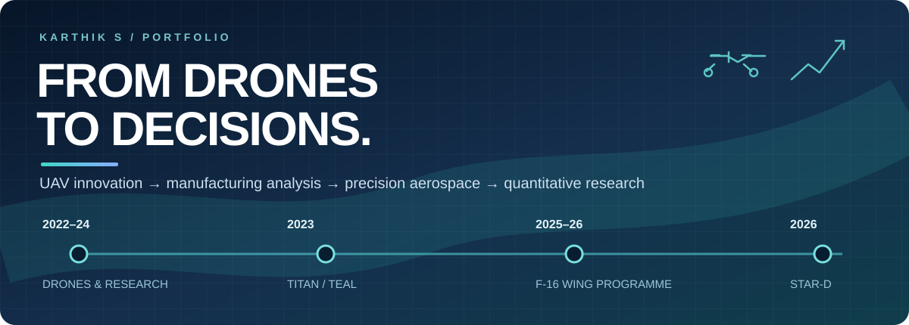

  

<h1 align="center">Hi, I'm Karthik S 👋</h1>

<b>Aeronautical Engineer | Aerospace Operations | Aspiring Business & Quantitative Analyst</b>

  
  

> **Curiosity took me from college drone workshops to technology summits, precision manufacturing and the F-16 wing programme. Today I'm applying those experiences to data, quantitative research and business decision-making.**

## 01 / The beginning: drones, innovation & people (2022–2024)

At **Mangalore Institute of Technology & Engineering (MITE)**, my education extended far beyond lectures. I helped build and maintain UAVs, ran demonstrations, joined workshops and learned directly from founders, engineers and researchers.

| Where curiosity took me | My involvement |
|---|---|
| **Equinox — agricultural UAV** | Worked on a government-supported, NAIN-incubated quadcopter concept using multispectral imaging to identify crop disease. **Showcased Equinox at Bengaluru Tech Summit 2022**, representing MITE. |
| **Medical Emergency Drones (Med-E-Drones)** | Technical lead on a NAIN-supported **hybrid VTOL medical-response UAV**; supported technical research, assembly, maintenance and documentation. |
| **3D printing & drone workshops** | Helped conduct a hands-on **3D printing demonstration for junior students (August 2023)**. Expanded my practical exposure through drone-building, assembly, piloting and autonomous-mission training at MITE and Manipal. |
| **Ideas & collaborative projects** | Pitched a **Drone Security Systems** concept at IDEATHON 3.0; participated in **SAE India Aerothon 2024** as Team Ikarus lead. |

### My Bengaluru Tech Summit journey

| Year | Experiences and takeaways |
|---|---|
| **2022 — Showcasing** | Represented MITE with the **Equinox** drone project. The first major opportunity to explain a technical idea outside college. |
| **2023 — Exploring startups** | Participated with MITE's innovation community, including posts about the **Dhyuloka Solutions** team and **Rosette Smart Life**. Explored startup booths and learned how teams turn ideas into demonstrations and business propositions. |
| **2024 — Learning from industry** | Visited exhibitions featuring the **DRDO TAPAS UAV**, **ISRO's launch-vehicle programmes** and emerging aerospace companies. Interacted with teams or representatives associated with **Okulo Aerospace, BotLab Dynamics, COMRADO Aerospace** and the **ARTPARK** ecosystem. Also explored sustainability-oriented technology and e-waste art. |

Beyond the summit, I shared takeaways from **Mangaluru TechnoVanza 3.0**, an industry-focused **36th aerospace engineers' convention**, and interactions at technology exhibitions, including **Lekha Wireless**. These were **learning, networking and exhibition experiences**, not employment or joint projects.

The events and interactions above are documented in my LinkedIn posts; individual conversations should not be interpreted as endorsements or formal partnerships. <a href="https://www.linkedin.com/in/karthiks2003/">See my LinkedIn journey.</a>

## 02 / Titan Engineering & Automation: where I started questioning numbers

**Project Trainee · Titan Engineering & Automation Limited (TEAL), Hosur · Oct–Nov 2023**

At TEAL, I moved from prototypes to **actual manufacturing-performance problems**. A three-day time study comparing shop-floor observations with digital records exposed a serious measurement mismatch:

| **67.15%** | **5.84%** |
|:---:|:---:|
| Actual observed operating time | Machine monitoring system's reported operating time |
| **Same milling machine**, according to my internship study | **A data-quality problem, not a productivity collapse** |

We investigated potential signal and data-interpretation issues and raised them for review. A separate **vertical turning lathe (VTL) setup** project involved process mapping, operator interviews, market research, vendor comparisons and improvement proposals presented to management. One proposed change aimed for an **estimated 25% reduction in a setup activity**; it was **not a verified implemented saving**.

**My takeaway:** before trusting a KPI, check how it was measured. That lesson now guides both my technical and financial research.

## 03 / Tata Lockheed Martin: putting analysis into execution

  
  &nbsp;&nbsp;&nbsp; × &nbsp;&nbsp;&nbsp;
  

<strong>Tata Lockheed Martin Aerostructures Limited (TLMAL) · F-16 Wing Programme · Hyderabad</strong>

**Tooling Intern (Mar–Jun 2025).** Learned the end-to-end flow from tool drawings and dimensional verification to BOM checks, traceability, discrepancy reports, tool buy-off and handover to production. My tooling internship report documents hands-on gauges, component jigs, drill plates, coordination with Tooling Quality and Manufacturing Engineering, and structured Excel reporting.

**Junior Executive — Production (Dec 2025–Nov 2026).** Supported daily operational readiness reviews and production plans; worked across Quality, Tooling, Planning, Supply Chain and Manufacturing Engineering to resolve constraints and improve aircraft wing assembly processes.

| **45%** | **15%** | **~42%** | **30+** |
|:---:|:---:|:---:|:---:|
| Less time for a critical skin-installation activity | Reduction in recurring production discrepancies | Reduction in average tool handover delay | Operators & technicians coordinated |

These are initiative-level results reported in my CV, not company-wide results or independently audited figures. Company names and marks identify my experience, not endorsement.

## 04 / Research, prototypes & leadership

**Hybrid VTOL UAV — Final Year Project (2024–25).** Led a four-member team through modelling, fabrication and flight-test work. In **MATLAB/Simulink**, our model held altitude deviation within approximately **1 m** under simulated disturbances. Presented our research at **ERCAM 2024**, followed by publication in **IJSDR (January 2025)**.

**Team Ikarus — SAE India Aerothon 2024.** Led multidisciplinary UAV design for disaster-management applications; used planning, responsibility matrices and coordination to move from concept to evaluation.

**Education:** B.E. Aeronautical Engineering, MITE / Visvesvaraya Technological University (2025) · **CGPA 8.94/10**.

## 05 / What I'm building now: STAR-D 📊

[**STAR-D — Systematic Trading Research & Decision Analytics**](https://github.com/elvorkart3006-del/trading-quant-system) is my independent, AI-assisted Python research platform for systematic trading analysis and evidence-based decision-making.

| **7** | **1,241** | **2** |
|:---:|:---:|:---:|
| Indian equities studied | Daily historical sessions per stock | Strategies evaluated: SMA 6/30 & DC 5% |

I have built backtesting scripts, a **Streamlit analytics dashboard**, transaction-cost and sensitivity studies, offline checks and documented research comparisons.

**An important limitation:** in one historical study the DC 5% approach averaged **+3.28% net** across seven stock simulations, falling to **−2.17%** under severe assumed trading costs. These are **historical simulations, not actual profits**. Live trading remains disabled; forward profitability is unproven.

[**Explore the STAR-D repository, verified results, and roadmap →**](https://github.com/elvorkart3006-del/trading-quant-system)

## 06 / My toolkit & career direction

| Business & operations | Data & research | Engineering & delivery |
|---|---|---|
| Problem structuring, root-cause analysis, process improvement, stakeholder collaboration, performance reporting, vendor research | **Excel**, **Power BI**, **Python**, pandas, NumPy, Matplotlib, Streamlit, SQLite, visualisation and backtesting | MATLAB/Simulink, UAV development, CATIA V5, Siemens NX, manufacturing coordination and technical documentation |

**Learning:** Project Management Foundations · Six Sigma Green Belt coursework · Python Essentials · Power BI · Lean and aerospace quality practices.

I am pursuing opportunities in **Business Analysis, Data Analytics, Strategy/Management Consulting and Quantitative Finance Research**. My operational experience gives me practical questions to ask; my current research is developing the tools to answer them more rigorously.

---

<strong>Build with curiosity. Verify with evidence. Improve what matters.</strong>

<a href="https://www.linkedin.com/in/karthiks2003/">My LinkedIn</a> · <a href="https://github.com/elvorkart3006-del/trading-quant-system">STAR-D</a>

This public page is an independent portfolio drawn from my CV, internship reports and LinkedIn posts. Private work documents, internal company images, phone and email information are intentionally excluded.
